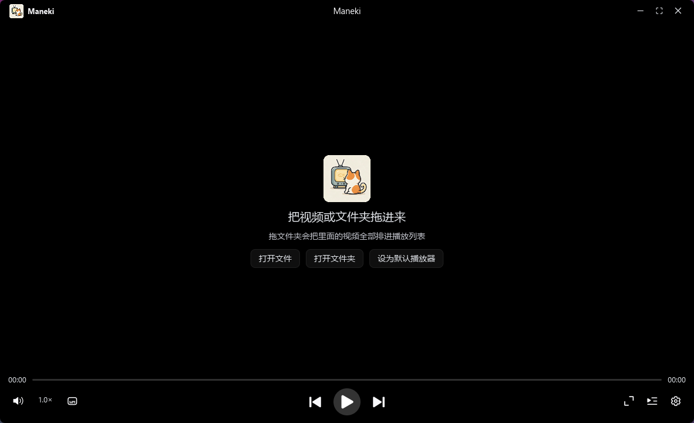
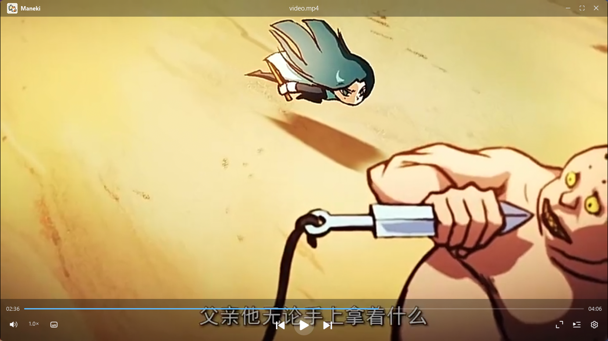
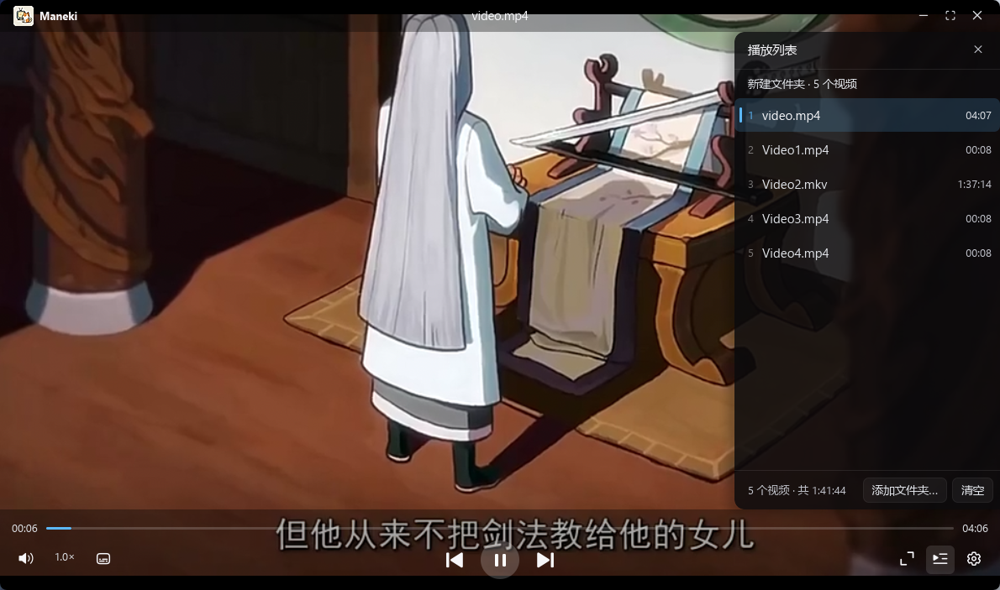

# Maneki

**用 Rust + iced 写的 Windows 视频播放器**


## 页面展示

### 常规页面



### 播放界面



### 播放列表



### 干净的播放窗口


## 特性

**播放**

- 打开时窗口按视频比例摆好，画面铺满、不留黑边；换集只换片子，不动窗口尺寸
- 顶栏和底栏在鼠标静置 2 秒后收起，鼠标一动就滑回来
- 换片空档在画面中央转一圈，首帧到手立刻收（秒开的小文件不会闪）
- 播放速度 0.5×–8.0×，预设 + 自定义滑杆，连播时保持不变
- 音量、字幕、速度三块浮层都从底栏上方弹出
- 音频用 rodio 直接送声卡，界面换成一块「唱片」：播放时光晕缓慢呼吸，暂停就停住

**画面**

- 填充方式：默认（保持比例）/ 铺满 / 拉伸
- 画面比例：自动 / 16:9 / 4:3 / 5:4 / 21:9
- 色彩调整：亮度、对比度、饱和度、色调、锐度

**文件**

- 打开方式：拖文件、拖文件夹、命令行参数、文件关联，四种都行
- 拖进来的是**单个文件**就直接播；是**文件夹**就只装列表、拉开抽屉停在「从列表里挑一个」，
  不替用户决定先放哪一条（几百集的剧、一整张专辑，默认播第一条往往不是想看的），
  按播放键 / 空格也会从第一条起播
- 播放列表带时长（后台线程探测，不挡打开）
- 单例：再次双击 exe 不会开第二个窗口，路径转交给已经在跑的那个实例
- 右键菜单：在资源管理器中打开 / 查看视频文件详情（容器、编码、码率、轨道…）
- 全屏时窗口是钉死的，拖不动也拉不动

## 为什么能秒开

不是靠「预读更多」，恰恰相反——`src/mpv.rs` 里把这几个值全调低了：

| 选项 | 这里的值 | libmpv 默认 |
| --- | --- | --- |
| `cache` | `no` | `auto` |
| `demuxer-lavf-probesize` | `32768`（32 KiB） | 5 MiB |
| `demuxer-lavf-analyzeduration` | `1`（秒） | 5 秒 |
| `demuxer-readahead-secs` | `0.5` | 1.0 |
| `demuxer-max-bytes` | `64MiB` | 150 MiB |

内存占用和文件大小无关：不 cache、缓冲上限固定，开 50 GB 的片子和开 50 MB 的占一样多。

另外 `config=no`、`load-scripts=no`、`osc=no`、`idle=yes` —— 不读用户配置、不跑 Lua 脚本、不带内置 OSD，启动时少干一大堆活。

## 为什么拖窗口不卡

播放线程独占 `Mpv`，解码和取帧都跑在那条线程里，UI 线程每帧只收最新一帧（一个 `Arc<Vec<u8>>`）。

窗口拖动和边缘缩放都是自己算好位置调 `SetWindowPos`，**不走** win32 的 `WM_NCLBUTTONDOWN(HTCAPTION)`——那个会进系统的模态移动循环，把 UI 线程整个占住，表现就是「声音还在放、画面冻住，松手才恢复」。

## 快捷键

| 键 | 作用 |
| --- | --- |
| `Space` | 播放 / 暂停 |
| `→` / `←` | 快进 / 快退 5 秒（按住不放会连续走，60ms 节流一次） |
| `↑` / `↓` | 音量 +5 / -5（0–100） |
| `Esc` | 逐层收起：右键菜单 → 浮层 → 抽屉 → 退出全屏 |

## 支持的格式

**视频**（libmpv 解码）

`mp4` `mkv` `avi` `mov` `flv` `wmv` `webm` `ts` `m2ts` `mts` `rmvb` `rm` `m4v` `mpg` `mpeg` `ogv` `3gp` `vob` `asf`

**音频**

- 走 rodio（symphonia / claxon / hound / lewton）：`mp3` `flac` `wav` `ogg` `m4a` `aac`
- 上面这些 rodio 解不了的，自动回退给 libmpv：`wma` `ape` `opus` `mka` `mp2` `ac3` `dts` …
- 拖文件夹时音频和视频一起收进列表，按文件名自然排序，放完照样能自动接下一首

实际能不能放，最终取决于你的 libmpv 里那份 FFmpeg 构建（音频那几种要看 rodio 的）。

音频用 rodio 而不是也交给 mpv：放一首歌不该占着一份 1080p 的软件渲染缓冲，
从 WASAPI 直接送采样，内存只有解码器那点缓冲，暂停 / 拖动也不用绕一层属性系统。

## 环境

- Windows 10 / 11（x64）
- Rust 1.85+（用的是 edition 2024）
- `libmpv-2.dll` —— **不在仓库里**，116 MB，超过 GitHub 单文件 100 MB 的硬限制

## 先拿到 libmpv-2.dll

整个播放器的解码、解封装全靠这一个 DLL：`maneki.exe` 自己只有十来 MB，里面一行解码代码都没有。

**不参与编译链接**。程序是用 `libloading` 在运行时 `LoadLibrary` 它的，所以 `cargo build` 不需要这个文件，
**只有运行 exe 才需要**。找不到时程序会在窗口里报错，并把找过的路径一条条列出来。

### 1. 下载

上游是 mpv 官方的 Windows 第三方构建（SourceForge 的 `mpv-player-windows` 项目）：

- 目录页：<https://sourceforge.net/projects/mpv-player-windows/files/libmpv/>
- 直接下最新 x64 版（2026-11-01 构建，就是本项目在用的那一份）：
  <https://sourceforge.net/projects/mpv-player-windows/files/libmpv/mpv-dev-x86_64-20261101-git-48fca90e8c.7z/download>

包名里的 `48fca90e8c` 是 mpv 的提交哈希，和 DLL 的「文件属性 → 详细信息」里的
`v0.41.0-1374-g48fca90e8` 是同一个东西。想换新版就去目录页挑日期最新的
`mpv-dev-x86_64-<日期>-git-<哈希>.7z`（**别选 `-v3` 那个**，那是要求 AVX2 的变体，
老一点的 CPU 会直接起不来）。

### 2. 解压并放到 `vendor\`

用 7-Zip 解开（Windows 自带的不认 7z）：

```powershell
# 在仓库根目录执行，路径按你实际下载到的地方改
& "C:\Program Files\7-Zip\7z.exe" x "$env:USERPROFILE\Downloads\mpv-dev-x86_64-20261101-git-48fca90e8c.7z" -o.\vendor -y
```

只要那个 DLL 也行，但**目录和文件名都不能改**：

```
Maneki\
├── Cargo.toml
├── package.ps1
├── src\
└── vendor\                     <- 就放在这里（和 Cargo.toml 同级）
    └── libmpv-2.dll            <- 文件名必须一模一样，116 MB
```

完整压缩包里其实有这几样，一起解到 `vendor\` 也没问题（多出来的本项目用不到）：

```
vendor\
├── libmpv-2.dll        程序运行时真正加载的
├── libmpv.dll.a        导入库，本项目走 libloading，不链接它
└── include\mpv\*.h     C 头文件，同上，只是给想自己写 FFI 的人看
```

### 3. 校验

```powershell
Get-Item .\vendor\libmpv-2.dll | Select-Object Length, @{n='Version';e={$_.VersionInfo.FileVersion}}
```

对得上就是好的：`121474048` 字节（115.8 MB）、版本 `v0.41.0-1374-g48fca90e8`。
文件小得离谱（几 MB）说明下成了解码器分离的 zip 或者半截文件。

### 程序会去哪儿找它

`src/mpv.rs` 的 `libmpv_candidates()` 按这个顺序试，命中第一个就用：

1. `maneki.exe` 同目录 —— 安装后的形态；
2. `maneki.exe` 同目录下的 `vendor\`；
3. 从 exe 所在目录**逐级往上找 6 层**的 `vendor\libmpv-2.dll` —— 开发时
   `target\release` 往上两级正好是仓库根，所以放在 `vendor\` 就能跑；
4. 当前工作目录下的 `libmpv-2.dll` / `vendor\libmpv-2.dll`（兜底）。

之所以要往上找而不是写死相对路径：双击 exe、或者把视频拖到 exe 图标上时，
进程的工作目录是 exe 所在目录，相对路径 `vendor\libmpv-2.dll` 必然找不到。

## 构建

```powershell
git clone https://github.com/xarzhi/Maneki.git
cd Maneki

# 按上面「先拿到 libmpv-2.dll」把 DLL 放进 .\vendor\

cargo build --release
.\target\release\maneki.exe "D:\某个视频.mp4"
```

`cargo run --release -- "D:\某个视频.mp4"` 也能跑，DLL 会从仓库根的 `vendor\` 里找到。

## 打包安装包

```powershell
powershell -ExecutionPolicy Bypass -File .\package.ps1 0.1.0
```

产物在 `dist\Maneki_0.1.0_x64-setup.exe`。几个细节：

- 版本号唯一来源是 `Cargo.toml` 的 `version`：脚本改完会让 `build.rs` 重新渲染 `assets/app.rc`，再从产物的版本资源里读回来校验，对不上就报错；
- 安装向导里选完目录，程序会再套一层 `Maneki` 子目录（`...\Tools` → `...\Tools\Maneki`），不会把 exe 和 uninstall.exe 直接撒在父目录里；
- `vendor\libmpv-2.dll` 会一起打进安装包，装完直接能播。

## 代码结构

| 文件 | 职责 |
| --- | --- |
| `main.rs` | 应用状态、消息、视图与布局 |
| `mpv.rs` | libmpv 的最小 FFI 封装，以及上面那批启动选项 |
| `player.rs` | 播放线程：解码、取帧、回报状态快照；视频走 libmpv，音频走 rodio |
| `audio.rs` | 纯音频播放（rodio）：打开 / 暂停 / 跳转 / 音量 / 倍速，以及音频后缀表 |
| `video.rs` | 上屏：把一帧 RGBA 当纹理采样画出来，附带填充 / 比例 / 调色 |
| `playlist.rs` | 目录扫描、自然排序、播放列表抽屉 |
| `settings.rs` | 设置抽屉 |
| `info.rs` | 文件详情抽屉 |
| `subtitle.rs` | 字幕浮层 |
| `spinner.rs` | 换片转圈 |
| `assoc.rs` | 文件关联（全部写在 HKCU，不需要管理员权限） |
| `single.rs` | 单例互斥体 + 命名管道 |
| `win32.rs` | Windows 原生窗口微调：无边框、圆角、拖动、缩放、置顶 |
| `ui.rs` / `icon.rs` | 跨面板的小工具 / 图标字体接入 |

## 已知限制

- 只有 Windows：`win32.rs` 里全是原生调用，没有做跨平台抽象
- 字幕只走 libmpv 自己的渲染，样式不可调
- **不能切音轨**：多音轨的片子目前只能用 libmpv 挑的第一条（字幕可以选，音轨还没做）
- 音频的时长以后台探测（libmpv）为准：rodio 对 mp3 的时长是**估算**的，实测 42 秒的
  mp3 会报成 46 秒；探测值没回来之前先用它顶着，回来后立刻换掉

## 许可证

[MIT](LICENSE) © 2026 xarzhi
